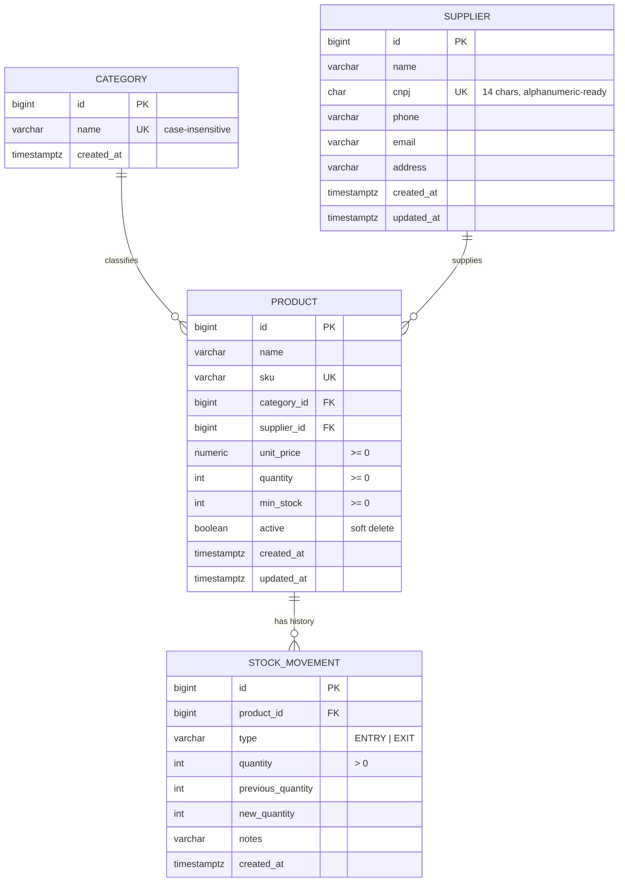

# Dismar Stock

<p align="center">
  
</p>

<p align="center">
  A lightweight inventory management web application built with HTML, CSS and vanilla JavaScript.
</p>

<p align="center">
  
  
  
  
</p>

## 📦 About the Project

**Dismar Stock** is a browser-based inventory management system designed to make product, supplier, and stock control simple and organized.

The application provides a complete dashboard with inventory statistics, product and supplier management, stock movement history, reports, low-stock alerts, and theme customization.

Data is currently stored locally in the browser using `localStorage`, allowing the application to run without requiring a backend server or database.

## ✨ Features

### 📊 Dashboard

* Total number of registered products
* Total units currently in stock
* Total inventory value
* Low-stock product count
* Most valuable products
* Recent stock movements
* Quick product search

### 📦 Product Management

* Create products
* Edit existing products
* Delete products
* SKU identification
* Product categories
* Unit price management
* Quantity control
* Minimum stock level configuration
* Supplier association
* Product search
* Low-stock filtering
* Out-of-stock filtering

### 🏢 Supplier Management

* Create suppliers
* Edit supplier information
* Delete suppliers
* Store CNPJ
* Phone number
* Email address
* Physical address
* View the number of products associated with each supplier
* Prevent deletion of suppliers that still have linked products

### 🔄 Stock Movements

* Register stock entries
* Register stock exits
* Prevent negative stock quantities
* Automatically record stock changes
* Store movement date and time
* Track previous and new quantities
* Filter movements by entry or exit

### 📈 Reports

* Average inventory value per product
* Number of registered categories
* Number of stock movements
* Inventory value grouped by category
* Percentage distribution of inventory value

### ⚠️ Inventory Alerts

* Low-stock warnings
* Out-of-stock warnings
* Configurable minimum stock levels
* Quick stock replenishment actions

### 🌙 Interface

* Light theme
* Dark theme
* Persistent theme preference
* Dashboard-style interface
* Clean and organized navigation

---

## 🛠️ Tech Stack

| Technology   | Purpose                                |
| ------------ | -------------------------------------- |
| HTML5        | Application structure                  |
| CSS3         | Layout and visual styling              |
| JavaScript   | Application logic and DOM manipulation |
| LocalStorage | Browser-side data persistence          |
| Google Fonts | Inter font family                      |
| PostgreSQL   | Relational database *(in progress, see [Data Model](#-data-model))* |
| Flyway       | Versioned database migrations *(in progress)* |

---

## 📁 Project Structure

```text
dismar_stock/
├── index.html            # Main application page
├── style.css             # Application styles
├── script.js             # Application logic and data management
├── dismar_PNG.png        # Application icon
├── logo_dismar_PNG.png   # Project logo
├── backend/
│   └── src/main/resources/db/
│       ├── migration/    # Flyway migrations (database schema)
│       └── seed/         # Sample data for development
├── LICENSE               # MIT License
└── README.md             # Project documentation
```

---

## 🚀 Getting Started

Dismar Stock is a front-end application and does not currently require dependency installation.

### 1. Clone the repository

```bash
git clone https://github.com/sknpz/dismar_stock.git
```

### 2. Open the project directory

```bash
cd dismar_stock
```

### 3. Run the application

Open:

```text
index.html
```

directly in your browser.

For development, you can also run the project using a local web server such as the **Live Server** extension for Visual Studio Code.

---

## 💾 Data Storage

Dismar Stock currently stores application data directly in the user's browser using `localStorage`.

The following information is stored:

* Products
* Suppliers
* Stock movements
* Theme preferences
* Application configuration

Because the data is stored locally, it is associated with the browser and device being used.

Clearing the browser's local storage will remove the saved inventory data.

---

## 🗄️ Data Model

The application is being migrated from `localStorage` to a **PostgreSQL** database (hosted on Supabase), accessed through a REST API. The schema is versioned with Flyway in [`V1__create_schema.sql`](backend/src/main/resources/db/migration/V1__create_schema.sql).



### Design decisions

| Decision | Reason |
| --- | --- |
| **Categories in their own table** | Prevents the same category from being typed in different ways ("Tools", "tools", "Tool") and keeps reports consistent. Uniqueness is case-insensitive. |
| **`ON DELETE RESTRICT` on supplier** | A supplier with linked products cannot be deleted. The database enforces this rule, so the UI isn't the only thing protecting it. |
| **Products use soft delete (`active`)** | Stock movement history must keep pointing to the product it belongs to, so products are deactivated instead of deleted. |
| **`CHECK` constraints on stock** | Negative stock, negative prices and movements whose balance doesn't add up (`new = previous ± quantity`) are rejected by the database itself. |
| **`NUMERIC(12,2)` for prices** | Exact decimal arithmetic. Floating-point types cause rounding errors with money. |
| **CNPJ stored without punctuation** | Avoids duplicates such as `11.222.333/0001-81` vs `11222333000181`. The format also accepts the alphanumeric CNPJ issued since July 2026. |
| **Indexes on foreign keys** | PostgreSQL does not index foreign keys automatically, and these columns are used in joins and filters. |

Sample data for development is available in [`dev_seed.sql`](backend/src/main/resources/db/seed/dev_seed.sql).

---

## ⚠️ Current Limitations

The current version does not yet include:

* User authentication
* Cloud database synchronization
* Multi-user accounts
* Multi-company support
* Automatic backups
* Cross-device synchronization
* Server-side data persistence

---

## 🗺️ Roadmap

The project is evolving from a browser-only app into a full-stack application:

* [x] **Phase 0:** Front-end fixes (XSS protection, real dashboard metrics, modal bugs)
* [x] **Phase 1:** Relational data model (PostgreSQL + Flyway migrations)
* [ ] **Phase 2:** REST API with Java + Spring Boot
* [ ] **Phase 3:** Front-end consuming the API instead of `localStorage`
* [ ] **Phase 4:** User authentication with JWT
* [ ] **Phase 5:** Automated tests (JUnit) and CI with GitHub Actions
* [ ] **Phase 6:** Docker and cloud deployment

Ideas for later:

* [ ] CSV export and PDF reports
* [ ] Interactive dashboard charts
* [ ] Improved mobile responsiveness

---

## 🎯 Project Goals

Dismar Stock was created as a practical inventory management solution while also serving as a project for developing and applying skills involving:

* Front-end development
* JavaScript
* CRUD operations
* Data persistence
* UI/UX design
* Inventory management logic
* Business rules
* Software organization

---

## 📄 License

This project is licensed under the **MIT License**.

See the [LICENSE](LICENSE) file for more information.

---

## 👨‍💻 Author

Developed by **Matheus Sakuno**.

GitHub: [@sknpz](https://github.com/sknpz)

---

<p align="center">
  Made with ☕ and code.
</p>
