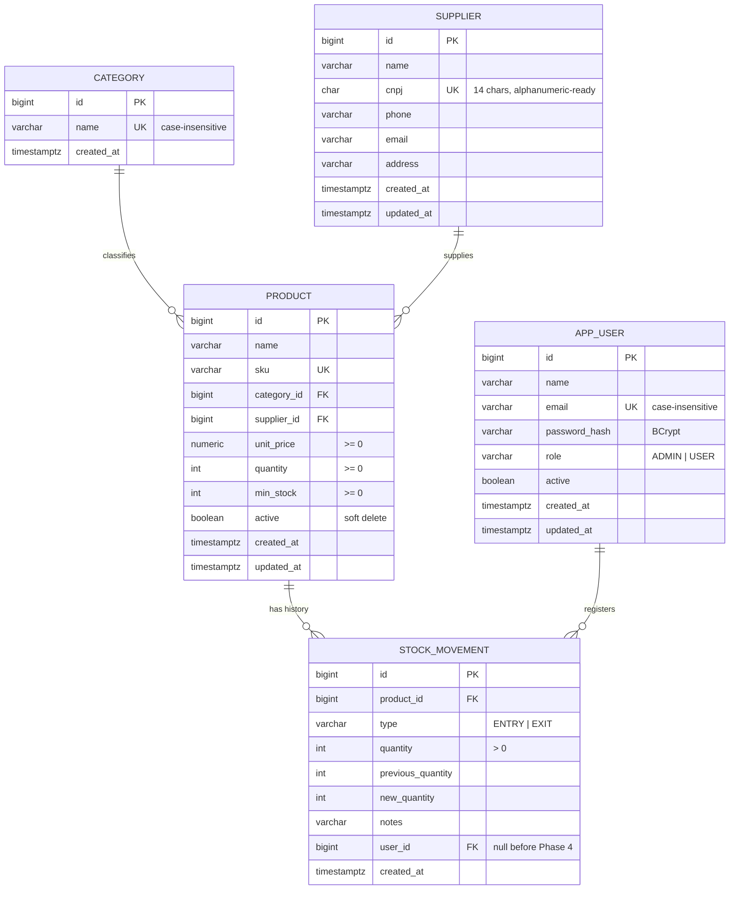

# Dismar Stock

<p align="center">
  
</p>

<p align="center">
  An inventory management application with a vanilla JavaScript front-end and a Java + Spring Boot REST API backed by PostgreSQL.
</p>

<p align="center">
  
  
  
  
  
  
  
</p>

## 📦 About the Project

**Dismar Stock** is an inventory management system designed to make product, supplier, and stock control simple and organized.

The application provides a complete dashboard with inventory statistics, product and supplier management, stock movement history, reports, low-stock alerts, and theme customization.

The project has two parts:

* **Front-end** (`index.html`, `style.css`, `script.js`, `api.js`): vanilla JavaScript that runs in the browser and reads and writes all data through the API.
* **REST API** (`backend/`): Java 21 + Spring Boot, persisting data in PostgreSQL and enforcing the business rules on the server.

## ✨ Features

### 📊 Dashboard

* Total number of registered products
* Total units currently in stock
* Total inventory value
* Low-stock product count
* Most valuable products
* Recent stock movements
* Quick product search

### 📦 Product Management

* Create products
* Edit existing products
* Delete products
* SKU identification
* Product categories
* Unit price management
* Quantity control
* Minimum stock level configuration
* Supplier association
* Product search
* Low-stock filtering
* Out-of-stock filtering

### 🏢 Supplier Management

* Create suppliers
* Edit supplier information
* Delete suppliers
* Store CNPJ
* Phone number
* Email address
* Physical address
* View the number of products associated with each supplier
* Prevent deletion of suppliers that still have linked products

### 🔄 Stock Movements

* Register stock entries
* Register stock exits
* Prevent negative stock quantities
* Automatically record stock changes
* Store movement date and time
* Track previous and new quantities
* Filter movements by entry or exit

### 📈 Reports

* Average inventory value per product
* Number of registered categories
* Number of stock movements
* Inventory value grouped by category
* Percentage distribution of inventory value

### ⚠️ Inventory Alerts

* Low-stock warnings
* Out-of-stock warnings
* Configurable minimum stock levels
* Quick stock replenishment actions

### 🔐 Users and Access

* Login with e-mail and password (JWT)
* Two profiles: **Administrador** manages users; **Usuário** operates the inventory
* Create users, change profiles, deactivate/reactivate and reset passwords (administrators)
* Change your own password
* Every stock movement records who registered it
* Deactivating a user blocks access immediately

### 🌙 Interface

* Light theme
* Dark theme
* Persistent theme preference
* Dashboard-style interface
* Clean and organized navigation

---

## 🛠️ Tech Stack

| Technology   | Purpose                                |
| ------------ | -------------------------------------- |
| HTML5        | Application structure                  |
| CSS3         | Layout and visual styling              |
| JavaScript   | Application logic and DOM manipulation |
| Fetch API    | Front-end calls to the REST API        |
| LocalStorage | Theme preference                       |
| Google Fonts | Inter font family                      |
| Java 21 + Spring Boot 4 | REST API (`backend/`) |
| Spring Data JPA / Hibernate | Data access |
| PostgreSQL   | Relational database (see [Data Model](#-data-model)) |
| Flyway       | Versioned database migrations |
| Spring Security (OAuth2 Resource Server) | JWT authentication and authorization |
| springdoc-openapi | Interactive API documentation (Swagger UI) |
| Testcontainers | Disposable PostgreSQL for automated tests |

---

## 📁 Project Structure

```text
dismar_stock/
├── index.html            # Main application page
├── style.css             # Application styles
├── script.js             # Pages, modals and rendering
├── api.js                # HTTP client for the REST API
├── dismar_PNG.png        # Application icon
├── logo_dismar_PNG.png   # Project logo
├── backend/              # REST API (Java + Spring Boot)
│   ├── compose.yaml      # Local PostgreSQL for development
│   ├── pom.xml
│   └── src/
│       ├── main/
│       │   ├── java/br/com/dismar/stock/
│       │   │   ├── category/ # One package per feature:
│       │   │   ├── supplier/ #   entity, repository, service,
│       │   │   ├── product/  #   controller and DTOs together
│       │   │   ├── movement/
│       │   │   ├── report/
│       │   │   ├── user/     # Users, profiles, first-admin bootstrap
│       │   │   ├── auth/     # Login, JWT issuing and validation
│       │   │   ├── config/   # Security (routes, CORS) and OpenAPI
│       │   │   └── shared/   # Error handling, CNPJ validation
│       │   └── resources/db/
│       │       ├── migration/ # Flyway migrations (database schema)
│       │       └── seed/      # Sample data for development
│       └── test/          # Integration tests (Testcontainers)
├── LICENSE               # MIT License
└── README.md             # Project documentation
```

---

## 🚀 Getting Started

The front-end has no dependencies to install, but it needs the API running to load and save data.

### 1. Clone the repository

```bash
git clone https://github.com/sknpz/dismar_stock.git
```

### 2. Open the project directory

```bash
cd dismar_stock
```

### 3. Run the API

Requirements: **Java 21** and **Docker**. Maven is not required, because the project includes the Maven Wrapper (`mvnw`).

```bash
cd backend
docker compose up -d     # starts PostgreSQL on port 5433
./mvnw spring-boot:run   # starts the API on http://localhost:8080
```

On startup, Flyway creates the tables automatically. To load the sample data:

```bash
docker compose exec -T postgres psql -U dismar -d dismar < src/main/resources/db/seed/dev_seed.sql
```

The sample data includes two users, both with the password `dismar123`:

| E-mail | Profile |
| --- | --- |
| `admin@dismar.local` | Administrador |
| `operador@dismar.local` | Usuário |

Interactive documentation: **http://localhost:8080/swagger-ui.html**. Call `POST /api/auth/login`, copy the `accessToken` and paste it into **Authorize** to try the protected endpoints.

| Environment variable | Default | Description |
| --- | --- | --- |
| `DB_URL` | `jdbc:postgresql://localhost:5433/dismar` | JDBC connection URL |
| `DB_USERNAME` / `DB_PASSWORD` | `dismar` / `dismar` | Database credentials (local only) |
| `PORT` | `8080` | HTTP port |
| `CORS_ALLOWED_ORIGINS` | Live Server + GitHub Pages | Front-end origins allowed to call the API |
| `JWT_SECRET` | random key per start | Key that signs the tokens (at least 32 characters). Without it, every restart logs everyone out, so always set it in production. |
| `JWT_EXPIRATION` | `8h` | How long a login lasts |
| `ADMIN_EMAIL` / `ADMIN_PASSWORD` / `ADMIN_NAME` | empty / empty / `Administrador` | Creates the first administrator on startup, **only if the database has no users yet** |

In production (without the sample data), set `ADMIN_EMAIL` and `ADMIN_PASSWORD` for the first start, log in as that administrator, and create the other users from the **Usuários** page.

Run the tests with `./mvnw test`. Docker must be running, because Testcontainers starts a temporary PostgreSQL.

### 4. Run the front-end

Serve the project folder on port **5500**, for example with the **Live Server** extension for Visual Studio Code, or with:

```bash
python -m http.server 5500
```

Then open **http://localhost:5500** and log in (see the sample users above).

> Opening `index.html` directly from the file system (`file://`) does not work: the browser sends the request with a `null` origin, which the API's CORS configuration rejects. To use another port, add its origin to `CORS_ALLOWED_ORIGINS`.

The front-end calls the API at `http://localhost:8080`. To point it somewhere else, define `window.DISMAR_API_URL` before `api.js` is loaded:

```html
<script>window.DISMAR_API_URL = 'https://my-api.example.com';</script>
<script src="api.js"></script>
```

If the API is unreachable, each page shows an error message with a **Tentar novamente** (try again) button instead of empty data.

---

## 🔌 API

Every endpoint except `POST /api/auth/login` requires the header `Authorization: Bearer <token>`.

| Method | Endpoint | Description |
| --- | --- | --- |
| `POST` | `/api/auth/login` | Log in with e-mail and password; returns the token, its expiration and the user |
| `GET` | `/api/auth/me` | Logged-in user |
| `PUT` | `/api/auth/password` | Change your own password (requires the current one) |
| `GET` / `POST` | `/api/users` | List and create users (**ADMIN only**) |
| `GET` / `PUT` | `/api/users/{id}` | View and update name, profile, status, or reset the password (**ADMIN only**) |
| `GET` | `/api/categories` | List categories |
| `POST` / `PUT` / `DELETE` | `/api/categories[/{id}]` | Create, rename, delete |
| `GET` | `/api/suppliers?search=` | List suppliers (search by name, CNPJ or e-mail) |
| `GET` / `POST` / `PUT` / `DELETE` | `/api/suppliers[/{id}]` | Supplier CRUD |
| `GET` | `/api/products?search=&status=&categoryId=&supplierId=&page=&size=&sort=` | Paginated product list with filters |
| `GET` / `POST` / `PUT` / `DELETE` | `/api/products[/{id}]` | Product CRUD (delete is a soft delete) |
| `POST` | `/api/products/{id}/movements` | Register a stock entry (`ENTRY`) or exit (`EXIT`) |
| `GET` | `/api/movements?type=&productId=` | Paginated movement history |
| `GET` | `/api/reports/summary` | Dashboard indicators and value by category |
| `GET` | `/api/reports/top-products?limit=` | Products with the highest stock value (quantity × unit price), 1 to 50 |

### Business rules

* **Stock only changes through movements.** `PUT /api/products/{id}` ignores quantity. The initial quantity given on creation is recorded as an `ENTRY` movement ("Estoque inicial"), so every unit in stock has a history.
* **Exits can't exceed the current balance.** The API responds with `422 Unprocessable Content`.
* **Concurrent movements are safe.** The product row is locked (`SELECT ... FOR UPDATE`) while a movement is registered, so two simultaneous exits can't read the same balance. [`StockMovementConcurrencyTests`](backend/src/test/java/br/com/dismar/stock/movement/StockMovementConcurrencyTests.java) fires 20 simultaneous exits of 1 unit at a product with 7 in stock and checks that exactly 7 succeed and the final balance is 0.
* **CNPJ is validated by its check digits**, with or without punctuation, including the alphanumeric format.
* **Missing or expired token → `401`; not enough permission → `403`.** Both use the same error format as the rest of the API.
* **Deactivation and profile changes take effect immediately.** The token carries only the user id; on every request the API checks the user's current status and profile in the database.
* **Passwords are stored with BCrypt.** The login answers "E-mail ou senha inválidos." for both an unknown e-mail and a wrong password, and takes the same time in both cases, so it doesn't reveal which e-mails are registered.
* **There is always an active administrator.** Administrators can't deactivate themselves or remove their own ADMIN profile.
* **Users are deactivated, not deleted**, so the movement history keeps pointing to who registered each movement.
* **Errors follow [RFC 9457](https://www.rfc-editor.org/rfc/rfc9457) (Problem Details)**, with per-field messages on validation errors:

```json
{
  "title": "Dados inválidos",
  "status": 400,
  "detail": "Um ou mais campos são inválidos.",
  "instance": "/api/products",
  "errors": { "unitPrice": "O preço unitário não pode ser negativo." }
}
```

---

## 💾 Data Storage

| Where | What |
| --- | --- |
| PostgreSQL (through the API) | Categories, suppliers, products and stock movements. See [Data Model](#-data-model). |
| Browser `localStorage` | The theme preference (`dismar_v2_config`) and the login session (`dismar_v2_session`: token, expiration and user). Logging out removes the session. |

Data saved by versions before Phase 3 (`dismar_v2_products`, `dismar_v2_suppliers` and `dismar_v2_movements` in `localStorage`) is no longer read, and it isn't imported into the database automatically. It is left untouched in the browser.

---

## 🗄️ Data Model

Data is stored in a **PostgreSQL** database (Supabase is the planned host), accessed through the REST API. The schema is versioned with Flyway in [`V1__create_schema.sql`](backend/src/main/resources/db/migration/V1__create_schema.sql) and [`V2__create_app_user.sql`](backend/src/main/resources/db/migration/V2__create_app_user.sql).



### Design decisions

| Decision | Reason |
| --- | --- |
| **Categories in their own table** | Prevents the same category from being typed in different ways ("Tools", "tools", "Tool") and keeps reports consistent. Uniqueness is case-insensitive. |
| **`ON DELETE RESTRICT` on supplier** | A supplier with linked products cannot be deleted. The database enforces this rule, so the UI isn't the only thing protecting it. |
| **Products use soft delete (`active`)** | Stock movement history must keep pointing to the product it belongs to, so products are deactivated instead of deleted. |
| **`CHECK` constraints on stock** | Negative stock, negative prices and movements whose balance doesn't add up (`new = previous ± quantity`) are rejected by the database itself. |
| **`NUMERIC(12,2)` for prices** | Exact decimal arithmetic. Floating-point types cause rounding errors with money. |
| **CNPJ stored without punctuation** | Avoids duplicates such as `11.222.333/0001-81` vs `11222333000181`. The format also accepts the alphanumeric CNPJ issued since July 2026. |
| **Table named `app_user`** | `user` is a reserved word in PostgreSQL. |
| **Indexes on foreign keys** | PostgreSQL does not index foreign keys automatically, and these columns are used in joins and filters. |

Sample data for development is available in [`dev_seed.sql`](backend/src/main/resources/db/seed/dev_seed.sql).

---

## ⚠️ Current Limitations

The current version does not yet include:

* Login rate limiting (repeated wrong passwords aren't throttled yet)
* Refresh tokens: when the session expires (`JWT_EXPIRATION`), the user logs in again
* Password recovery by e-mail (an administrator resets it instead)
* Multi-company support
* Automatic backups
* A deployed API and database (the API currently runs locally)

---

## 🗺️ Roadmap

The project is evolving from a browser-only app into a full-stack application:

* [x] **Phase 0:** Front-end fixes (XSS protection, real dashboard metrics, modal bugs)
* [x] **Phase 1:** Relational data model (PostgreSQL + Flyway migrations)
* [x] **Phase 2:** REST API with Java + Spring Boot
* [x] **Phase 3:** Front-end consuming the API instead of `localStorage`
* [x] **Phase 4:** User authentication with JWT
* [ ] **Phase 5:** Automated tests (JUnit) and CI with GitHub Actions
* [ ] **Phase 6:** Docker and cloud deployment

Ideas for later:

* [ ] CSV export and PDF reports
* [ ] Interactive dashboard charts
* [ ] Improved mobile responsiveness

---

## 🎯 Project Goals

Dismar Stock was created as a practical inventory management solution while also serving as a project for developing and applying skills involving:

* Front-end development
* JavaScript
* CRUD operations
* Data persistence
* UI/UX design
* Inventory management logic
* Business rules
* Software organization

---

## 📄 License

This project is licensed under the **MIT License**.

See the [LICENSE](LICENSE) file for more information.

---

## 👨‍💻 Author

Developed by **Matheus Sakuno**.

GitHub: [@sknpz](https://github.com/sknpz)

---

<p align="center">
  Made with ☕ and code.
</p>
